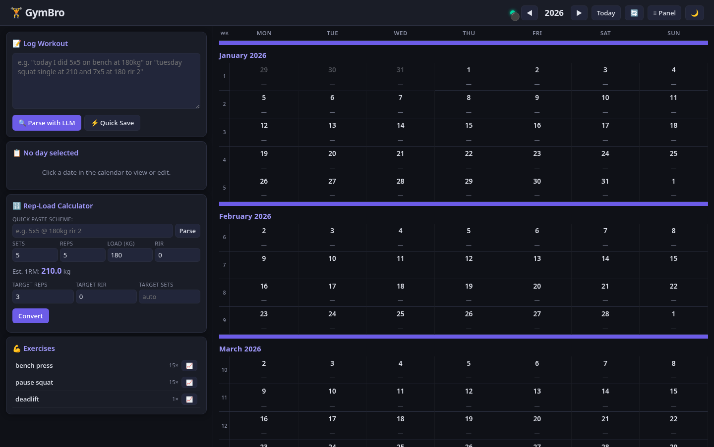
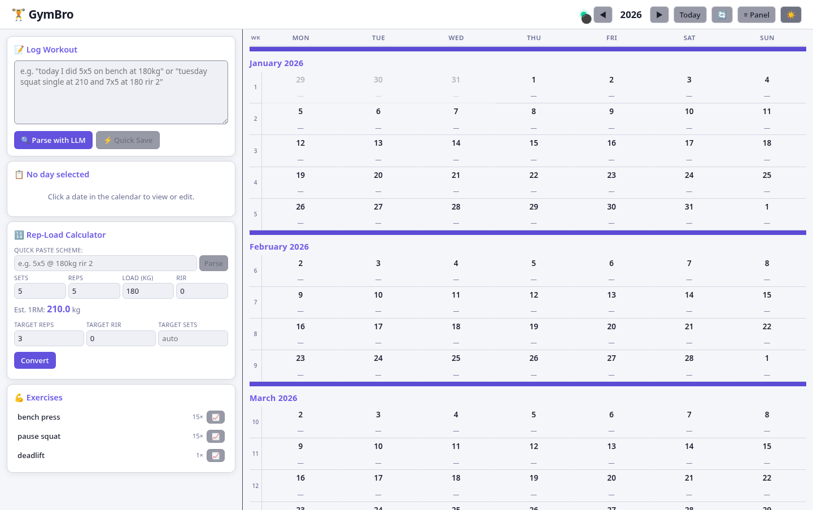

# GymBro 🏋️

A self-hostable gym workout tracker with AI-powered natural language logging, a rep-load calculator, and a full coach/trainee workflow.

| Dark | Light |
| --- | --- |
|  |  |

## Features

- **Natural-language workout logging** — type `"3 sets of 8 reps at 60kg on bench press"` (or any phrasing) and the AI parses it into structured exercise entries. Works with a local [LM Studio](https://lmstudio.ai/) endpoint or any OpenAI-compatible cloud provider (OpenAI, Groq, OpenRouter, DeepSeek, …). A regex fallback parser keeps logging working even with the AI endpoint offline.
- **Rep-load calculator** — converts between rep/set schemes at equal difficulty using Epley's 1RM formula with RIR (Reps In Reserve) and volume-matching adjustments. e.g. `"3×8 @ 60kg"` → equivalent `5×5` weight.
- **Yearly calendar** — a scrollable year view of training days; click a day to log or review a session.
- **Coaching workflow** — coach/trainee roles, coaching requests (with email invites for users who haven't signed up yet), programmed exercises, and trainee feedback (done / skipped + comments).
- **Progression charts** — estimated 1RM and volume trends per exercise.
- **Auth & roles** — email/password sessions (HttpOnly cookie, SQLite-backed) plus Google OAuth; three roles: admin / coach / trainee.

## Stack

| Layer | Tech |
| --- | --- |
| Backend | **Python / FastAPI** (uvicorn) |
| Frontend | **Jinja2** templates + vanilla JS (no build step) |
| Database | **SQLite** (zero-config, single file) |
| AI | LM Studio / OpenAI-compatible HTTP endpoints (httpx) |
| Deploy | Caddy (reverse proxy + TLS) + systemd — see [`deploy/DEPLOY.md`](deploy/DEPLOY.md) |

## Quick start

```bash
pip install -r requirements.txt
uvicorn app:app --reload --host 0.0.0.0 --port 8000
```

Open `http://localhost:8000` and sign up. The first account matching `ADMIN_EMAIL` becomes an admin.

### AI configuration (optional)

By default GymBro talks to a local LM Studio at `http://localhost:1234/v1/chat/completions`. To use a cloud provider instead, set in `.env` or the environment:

```env
AI_API_KEY=sk-...        # presence of this key switches to cloud mode
AI_BASE_URL=...          # optional (default: https://api.openai.com/v1)
AI_MODEL=...             # optional
# or force local mode:
AI_PROVIDER=lmstudio
LM_STUDIO_URL=http://localhost:1234/v1/chat/completions
```

Without any AI endpoint, the built-in regex parser still understands common entry formats.

### Google OAuth (optional)

Set `GOOGLE_CLIENT_ID` / `GOOGLE_CLIENT_SECRET` (and optionally `GOOGLE_REDIRECT_URI`) to enable "Sign in with Google".

## Deployment

[`deploy/DEPLOY.md`](deploy/DEPLOY.md) walks through a ~30-minute single-droplet DigitalOcean deployment: Ubuntu 24.04, Caddy for automatic HTTPS, and a systemd unit (`deploy/gymbro.service`, `deploy/Caddyfile`). Runs comfortably on the $6/mo 1GB droplet.

## Project layout

```
app.py         FastAPI routes, auth flows, page rendering
db.py          SQLite schema + all queries (users, workouts, timelines, coaching)
llm.py         AI integration: NL → structured workout entries, cloud/local modes
calculator.py  Rep-load math: Epley 1RM, RIR, volume matching
coaching.py    Coach/trainee requests, programmed exercises, feedback
auth.py        Password hashing, session tokens, request helpers
static/        Single-page frontend (vanilla JS)
templates/     Jinja2 shell
deploy/        Caddyfile, systemd unit, step-by-step deployment guide
```
